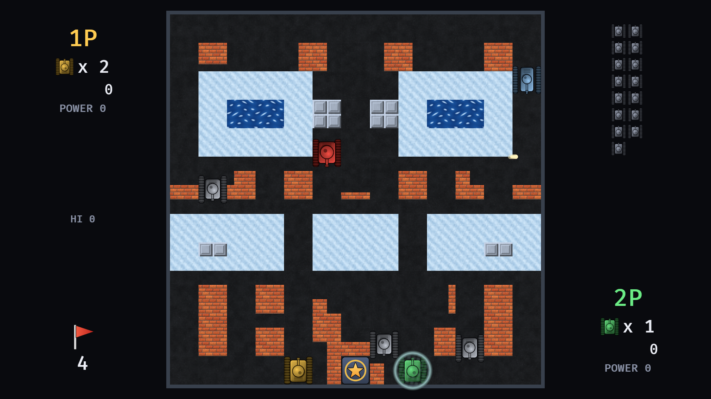
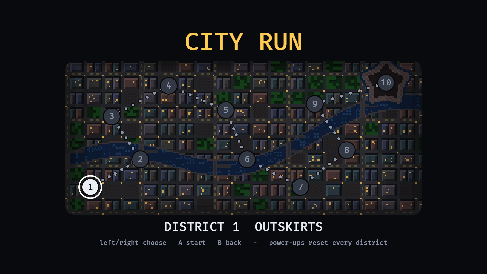
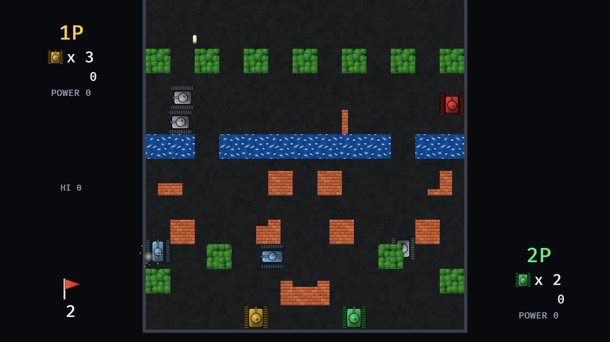
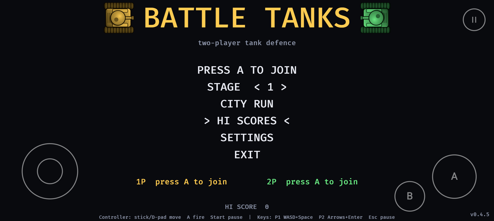

[Battle Tanks](https://github.com/Lunat1q/BattleTanks) is a tank game for one or two players, written in Rust with [Bevy](https://bevy.org/). It started as a couch game for the TV with two controllers. It now also runs on Android TV and Android phones, and it's in a closed test on Google Play. Google wants a closed test to run for 14 days before an app can go to production, so I need testers. This post is about the game and how to join.

## The game

**Classic**: 30 stages. Twenty enemy tanks per stage try to break through to your base. Brick walls you can shoot through, trees to hide in, ice to slide on, and power-ups: shields, a clock that freezes the enemy, a shovel that turns your base walls to steel, stars that upgrade your gun, grenades and extra tanks.



**City Run**: ten long scrolling districts, each with its own look (farms, market stalls, canals, ironworks, a frozen park, the harbour, rail yards, the citadel). You fight up through the streets, knock out the turrets guarding each fortress gate, take down mini-bosses and face a boss at the end. Every district hides three secret stashes inside its brick walls.





Other bits:

- One player, two players on one screen, or **LAN co-op**: two phones (or a phone and a TV) on the same Wi-Fi, each player on their own screen.
- World boards: enter a name of up to 7 letters at the end of a run and it goes on the online top list. City Run districts have time boards.
- Out of tanks? Borrow one from your partner.
- Controller rumble on hits, kills and boss takedowns.
- No ads, no in-app purchases, no accounts.

## Controls

- **TV**: a controller is best. Xbox, PlayStation, generic Bluetooth pads and the 2026 Steam Controller work. The TV remote works for menus and for one player.
- **Phone**: an on-screen stick on the left, fire (A) and B on the right, plus a pause button. A paired controller can join as player 2.

{: w="700" }

## How to become a tester

The app is paid on Google Play, so testers get a promo code and install it for free. Four steps:

1. **Join the Google Group** [battletanks-testers](https://groups.google.com/g/battletanks-testers) with the Google account you use on your phone or TV. Joining the group makes you a tester.
2. **Email me for a promo code** at **lunatiqapps@gmail.com** (template below). Use the same Google account address you joined the group with, so I can check it.
3. **Redeem the code**: in the Play Store app, tap your profile picture → **Payments & subscriptions** → **Redeem code**, or go to [play.google.com/redeem](https://play.google.com/redeem).
4. **Install** Battle Tanks from its Play Store page. On a TV, install it from the Play Store on the TV, or from the web page by picking the TV as the device.

> Please stay in the test (and keep the app installed) for at least 14 days. That's the period Google counts before the game can go to production.
{: .prompt-info }

### Email template

Copy, fill in, send to **lunatiqapps@gmail.com**:

```text
Subject: Battle Tanks tester: promo code

Hi,

I'd like to test Battle Tanks.

Google account (joined battletanks-testers with it): <your address>
Device(s): <e.g. Pixel 8 / Sony Bravia TV / Chromecast with Google TV>
Controller (if any): <e.g. Xbox, DualSense, none>

Thanks!
```

The device line helps: TVs and phones run different CPUs and GPUs, and that's exactly what I want covered.

## What to report

Anything that looks wrong, feels wrong or crashes. Useful details:

- the device and the game version (bottom-right corner of the title screen),
- what you did just before it happened,
- a screenshot or a short video, if you can.

Send it to the same address.

## No Android?

The Windows build is free: `BattleTanks.exe` from the [latest GitHub release](https://github.com/Lunat1q/BattleTanks/releases/latest) is the whole game. The source is on [GitHub](https://github.com/Lunat1q/BattleTanks).
