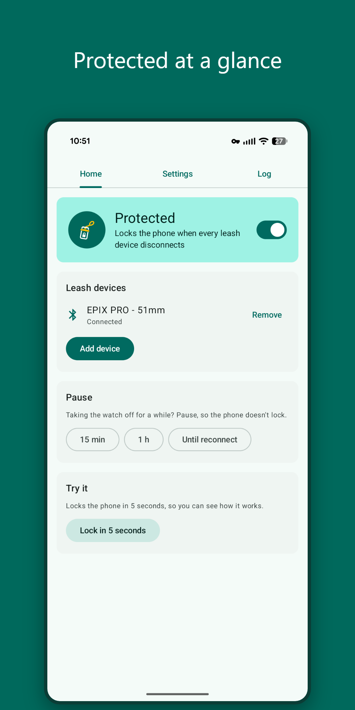
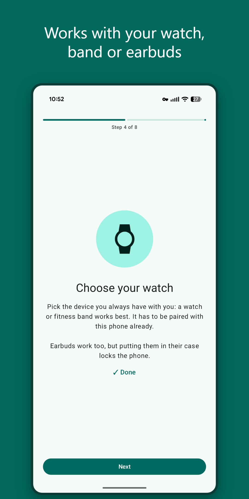
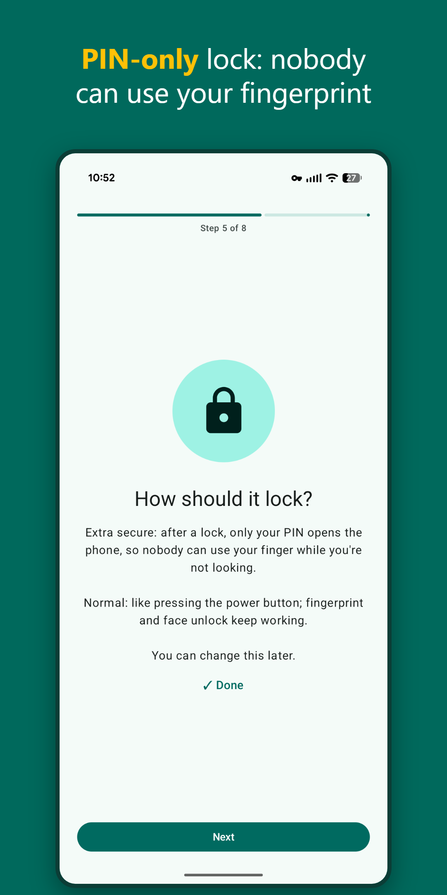
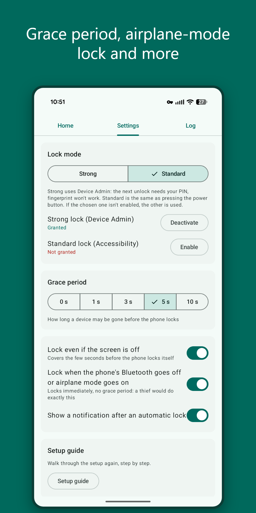

LeashLock is an Android app that ties your phone to a Bluetooth device you carry: a watch, a band, earbuds or headphones. When that device disconnects while the phone is unlocked, the phone locks itself. If someone grabs your unlocked phone and runs, or you leave it on a café table and walk away, it's behind your PIN again within seconds.

It's in a closed test on Google Play. Google wants a closed test to run for 14 days with enough testers before an app can go to production, so I need testers. This post is about the app and how to join.

## What it does

- **Locks when the leash breaks.** Bluetooth range is typically 10–30 m. A grace period (0–10 s, default 3 s) stops a short Bluetooth blip from locking you out.
- **Cutting the leash doesn't help.** Switching on airplane mode or switching off Bluetooth locks the phone immediately.
- **Two lock methods.** *Strong*: the next unlock needs your PIN, fingerprint and face are refused until then. *Standard*: same as pressing the power button, fingerprint and face still work.
- **Several devices.** Add a watch and earbuds, and it locks only when the last one is gone.
- **Pause** for a while, or until your device reconnects.
- **Event log** with every decision (locked, skipped and why), so you can see what happened.
- **Setup guide** on first run, one step per page, every step skippable. A checklist on the home screen shows anything still missing, and a notification tells you when the app can't protect the phone (Bluetooth permission revoked, lock method switched off, device removed).

{: w="300" }
{: w="300" }

{: w="300" }
{: w="300" }

## Privacy

LeashLock has no internet permission, so it can't send anything off the phone. No account, no ads, no analytics. It reads no notifications, messages or screen content. It knows only which Bluetooth devices you picked and whether they are connected. Full details: [privacy policy](/docs/leashlock/privacy/).

## Good to know

- Needs **Android 13** or newer, and the leash device must already be **paired** with the phone.
- Earbuds put in their case, headphones that power off when idle, or a multipoint headset switching to your laptop all count as a disconnect, and the phone locks. A watch or band that stays connected while you wear it works best.
- With Strong lock on, the app can't be force-stopped, and uninstalling it first needs Strong lock switched off in the app's settings. That's deliberate: a thief can't stop it either.

## How to become a tester

The app is free. Three steps:

1. **Join the Google Group** [leashlock-testers](https://groups.google.com/g/leashlock-testers) with the Google account you use on your phone. Joining the group makes you a tester.
2. **Opt in** to the test: open [play.google.com/apps/testing/com.lunatiq.leashlock](https://play.google.com/apps/testing/com.lunatiq.leashlock) with the same account and tap **Become a tester**.
3. **Install** LeashLock from its [Play Store page](https://play.google.com/store/apps/details?id=com.lunatiq.leashlock). It can take a few minutes after joining before the page shows up.

Then follow the setup guide and try a lock: walk away from your watch, or switch Bluetooth off.

> Please stay in the test (and keep the app installed) for at least 14 days. That's the period Google counts before the app can go to production.
{: .prompt-info }

## What to report

Send it to **lunatiqapps@gmail.com**. The most useful reports:

- **It didn't lock** when your device left, or **it locked** when it shouldn't have.
- The app stopped protecting after a while (some phones, Samsung especially, kill background apps; the setup checklist has a battery row for that).
- Anything confusing in the setup guide.

Please include:

- the phone (make and model) and the Android version,
- the leash device (e.g. Garmin watch, Galaxy Buds, Sony headphones),
- the lock method (Strong or Standard) and the grace period,
- what you did just before it happened, and a screenshot of the app's **Log** tab if you can.

### Email template

```text
Subject: LeashLock test report

Phone + Android version: <e.g. Galaxy S24, Android 15>
Leash device(s): <e.g. Pixel Watch 3, Galaxy Buds>
Lock method / grace period: <Strong or Standard / 3 s>

What happened:
<...>

What I expected:
<...>
```

Phones and Bluetooth devices differ a lot in how they report connections, so every new combination helps.
